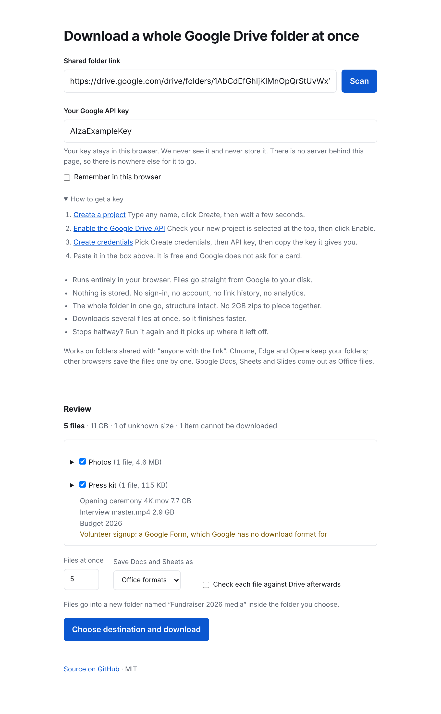

# GDrive Whole Folder Downloader

Download an entire public Google Drive folder to your disk in one pass, with the folder
structure intact.

**[Open the app](https://reddotconsultancy.github.io/gdrive-whole-folder-downloader/)**



## Why

Drive's own "Download folder" button zips everything on Google's servers and caps each
archive at about 2GB. Anything larger comes down as several zip files split wherever the
cap happened to fall, so the folder structure ends up spread across archives that have to
be reassembled by hand. Large folders also tend to fail partway through and leave you
with nothing to show for the wait.

This tool never zips. It reads the folder through the Drive API and writes each file
straight to its place on your disk, so what you get back is the folder.

## What it does

- Runs entirely in your browser. Files go straight from Google to your disk.
- Nothing is stored. No sign-in, no account, no link history, no analytics.
- The whole folder in one go, structure intact. No 2GB zips to piece together.
- Downloads several files at once, so it finishes faster.
- Stops halfway? Run it again and it picks up where it left off.

## Quick start

1. Open the app.
2. Get a free Google API key, following the steps on the page. It takes about two
   minutes and Google does not ask for a card.
3. Paste a Drive folder link shared as "anyone with the link".
4. Review what was found, untick anything you do not want, pick a destination folder.

Nothing downloads until you choose a destination.

## Requirements

| | |
|---|---|
| Folder sharing | "Anyone with the link". An API key cannot see anything narrower. |
| Browser | Chrome, Edge or Opera to rebuild folders on disk. Others still download every file, one at a time, to the Downloads folder. |
| API key | A free browser key with the Drive API enabled. |

## How it works

**Scan.** The folder is walked through the Drive API, several listings in parallel,
following `nextPageToken` for folders over 1000 items. Shortcuts resolve to their
targets and a visited-ID set keeps a shortcut pointing at an ancestor from looping
forever.

**Review.** The tree renders lazily, so a folder with thousands of files does not stall
the page. Counts and total size update as you untick folders.

**Download.** A worker pool of 1 to 10 fetches files concurrently. Each response body is
streamed chunk by chunk into a `FileSystemWritableFileStream`, so memory stays flat
whether the folder is 50MB or 50GB. Subfolders are created on demand as paths are walked.

**Recovery.** Rate limits back off exponentially with jitter and lower the concurrency on
their own. A dropped or truncated transfer deletes its partial file and retries, so a
half-written file can never be mistaken for a complete one. Before each file, anything
already on disk at Drive's reported size is skipped, which is what makes a cancelled run
resumable. Files that cannot be fetched at all are collected into a report rather than
stopping the run.

Architecture notes, including the parts that are less obvious than they look, are in
[docs/architecture.md](docs/architecture.md).

## Deploying your own copy

The app is a single static file. There is no build step, no dependencies and no server.

```bash
git clone https://github.com/reddotconsultancy/gdrive-whole-folder-downloader.git
cd gdrive-whole-folder-downloader
python3 -m http.server 8080
```

Then open <http://localhost:8080>.

To publish it, push to `main`. The included workflow enables GitHub Pages by itself and
deploys on every push. If the first run fails on permissions, set **Settings → Actions →
General → Workflow permissions** to **Read and write**, then re-run the job.

### Shipping a shared API key (optional)

Visitors paste their own key by default. To supply one instead, edit the single marked
line near the top of the script block in `index.html`:

```js
const API_KEY = "PASTE_YOUR_API_KEY_HERE";
```

Restrict it first, in the [Google Cloud Console](https://console.cloud.google.com/apis/credentials):
**API restrictions** to the Google Drive API only, and **Application restrictions** to
your own domain as an HTTP referrer. A browser key is public by design, so restricting it
is what stops someone else spending your quota.

### Social preview

`assets/og-image.svg` is the source. Convert it to a 1200x630 PNG at
`assets/og-image.png`; the meta tags already point there.

## Known limits

- **Google Docs, Sheets and Slides have no original bytes**, so they are exported to
  .docx, .xlsx and .pptx, or PDF if you prefer. Exports have their own size cap and very
  large documents can fail. Those appear in the report instead of stopping the run.
- **Forms, Sites, Jamboards and My Maps cannot be downloaded at all.** Google offers no
  export for them. They are listed as skipped rather than quietly dropped.
- **Google caps downloads per file.** A file many people have fetched recently returns a
  quota error to everyone, for about a day. No tool can work around it.
- **Without the File System Access API there are no folders.** Files land in Downloads
  one at a time with the path in the filename, and a re-run starts over, because a page
  cannot see what is already in your Downloads folder.

## FAQ

### Why does Google Drive split my folder into multiple 2GB zip files?

Google builds the zip on its servers before sending it and caps each archive at roughly
2GB. Anything larger is split, with the boundary falling wherever the cap is reached
rather than on any sensible folder edge. This tool does not zip at all, so the limit
never applies.

### How do I download a whole Google Drive folder at once?

Paste the folder's share link, scan it, choose a destination, and every file is written
into it with its subfolder structure preserved. No zipping, no reassembly.

### Is it safe to put an API key in a public web page?

A browser API key is meant to be public. It identifies your project, it does not grant
access to anything private, and it reads only files that are already shared publicly.
What is worth protecting is your quota, which is why the key should be restricted to the
Drive API and to your own domain. A key copied off your page will not work anywhere else.

### Why do I need an API key at all?

Listing the contents of a folder is an API call, and Google exposes no public endpoint
that returns a folder listing without one. The key makes the listing possible. It is not
a sign-in and it grants no access to your account.

### Does this work on private Google Drive folders?

No. It reads folders shared as "anyone with the link" only. Anything narrower needs a
Google sign-in flow, which this tool deliberately does not implement. No sign-in means no
account access and nothing to leak.

### Why does it say download quota exceeded?

Google temporarily caps downloads on individual files that have been fetched heavily.
The cap is applied on Google's side, across every user and every tool, and usually clears
within a day. The run continues and the affected files are listed in the report.

### Does this work in Safari or Firefox?

Yes, with one difference. Saving into a folder you choose needs the File System Access
API, which only Chrome, Edge and Opera have shipped. Everywhere else, every file still
downloads, but to your Downloads folder one at a time with the folder path in the
filename, like `Holiday photos_Day 1_beach.jpg`. The page says which of the two it is
doing before you start.

### How is this different from gdown?

[gdown](https://github.com/wkentaro/gdown) is a Python command-line tool: install Python,
install the package, run it in a terminal. This is a web page, so there is nothing to
install, and it writes straight into a folder you pick. gdown also scrapes
`drive.google.com` download pages, which a browser cannot do because those pages send no
CORS headers, so this tool uses the official Drive API instead.

## Contributing

See [CONTRIBUTING.md](CONTRIBUTING.md). The test plan is [docs/testing.md](docs/testing.md).

## License

MIT. See [LICENSE](LICENSE).
